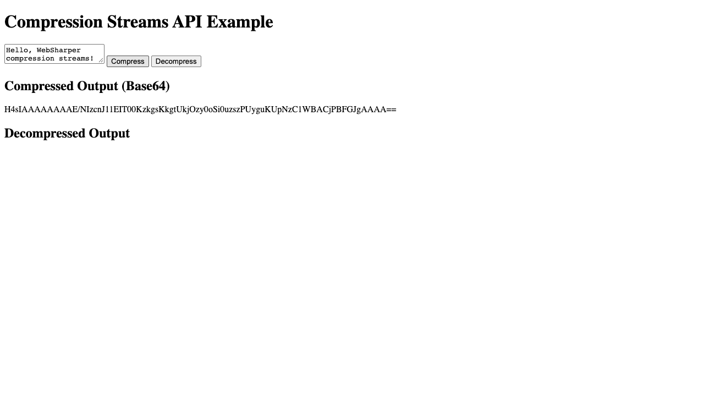

# WebSharper Compression Streams API Binding

[](https://www.nuget.org/packages/WebSharper.CompressionStreams)

This repository provides an F# [WebSharper](https://websharper.com/) binding for the [Compression Streams API](https://developer.mozilla.org/en-US/docs/Web/API/Compression_Streams_API), exposing `CompressionStream` and `DecompressionStream` so WebSharper applications can gzip/deflate data through the browser's native streams.

> **Browser support:** The Compression Streams API is available in current Chromium, Firefox and Safari releases. Check [MDN](https://developer.mozilla.org/en-US/docs/Web/API/Compression_Streams_API) for the latest compatibility matrix.

## Repository structure

The repository contains two projects:

| Project | What it is |
| --- | --- |
| `WebSharper.CompressionStreams` | The WIG binding (`CompressionStream`, `DecompressionStream`, and the `CompressionFormat` enum). |
| `WebSharper.CompressionStreams.Sample` | An ASP.NET Core SPA that exercises the binding end to end. See [Running the test case](#running-the-test-case). |

## Live demos

**Try it live:** [Open the sample in your browser](https://dotnet-websharper.github.io/CompressionStreamsAPI/)



The sample doubles as the binding's [test case](#running-the-test-case): it compresses text with gzip and decompresses it back in the browser.

- Binding sample (GitHub Pages): <https://dotnet-websharper.github.io/CompressionStreamsAPI/>
- Source: <https://github.com/dotnet-websharper/CompressionStreamsAPI>
- WebSharper bindings catalog: <https://websharper.com/bindings>

## Installation

```bash
dotnet add package WebSharper.CompressionStreams
```

## Usage

The binding surfaces the API as regular .NET types: construct a `CompressionStream` (or `DecompressionStream`) with a `CompressionFormat`, then `PipeThrough` it on a `ReadableStream`. A condensed version of the sample:

```fsharp
namespace WebSharper.CompressionStreams.Sample

open WebSharper
open WebSharper.JavaScript
open WebSharper.UI
open WebSharper.UI.Client
open WebSharper.UI.Templating
open WebSharper.CompressionStreams

[<JavaScript>]
module Client =
    type IndexTemplate = Template<"wwwroot/index.html", ClientLoad.FromDocument>

    let inputText = Var.Create ""
    let compressedData = Var.Create ""
    let decompressedData = Var.Create ""

    let encodeToBase64 (arrayBuffer: ArrayBuffer) =
        let uint8Array = Uint8Array(arrayBuffer) |> As<int array>
        JS.Window.Btoa(String.FromCharCode(uint8Array))

    let decodeFromBase64 (base64String: string) =
        let binaryString = JS.Window.Atob(base64String)
        let byteArray = [| for i in 0 .. binaryString.Length - 1 -> binaryString.[i] |> byte |]
        Uint8Array(byteArray).Buffer

    let compressText () =
        promise {
            let encoder = JS.Eval("new TextEncoder()")
            let data = encoder?encode(inputText.Value) |> As<ArrayBuffer>

            let blob = new Blob([| data |])
            let compressedStream =
                blob.Stream().PipeThrough(new CompressionStream(CompressionFormat.Gzip) |> As<ReadableWritablePair>)

            let response = new Response(compressedStream)
            let! compressedArrayBuffer = response.ArrayBuffer()

            compressedData.Value <- encodeToBase64 compressedArrayBuffer
        }

    let decompressText () =
        promise {
            if compressedData.Value = "" then return ()

            let compressedArrayBuffer = decodeFromBase64 compressedData.Value

            let blob = new Blob([| compressedArrayBuffer |])
            let decompressedStream =
                blob.Stream().PipeThrough(new DecompressionStream(CompressionFormat.Gzip) |> As<ReadableWritablePair>)

            let response = new Response(decompressedStream)
            let! decompressedArrayBuffer = response.ArrayBuffer()

            let decoder = JS.Eval("new TextDecoder()")
            decompressedData.Value <- decoder?decode(decompressedArrayBuffer)
        }

    [<SPAEntryPoint>]
    let Main () =
        IndexTemplate.Main()
            .InputText(inputText.V)
            .CompressedData(compressedData.V)
            .DecompressedData(decompressedData.V)
            .CompressText(fun _ -> async { do! compressText() |> Promise.AsAsync } |> Async.StartImmediate)
            .DecompressText(fun _ -> async { do! decompressText() |> Promise.AsAsync } |> Async.StartImmediate)
            .Doc()
        |> Doc.RunById "main"
```

## Running the test case

The sample doubles as the repository's test case. It covers:

- constructing `CompressionStream`/`DecompressionStream` with `CompressionFormat.Gzip`;
- piping a `Blob`'s `ReadableStream` through the compression stream;
- reading the compressed bytes back through `Response.ArrayBuffer()`;
- round-tripping the result through Base64 so the compressed payload can be shown in the UI;
- decompressing back to the original text.

Build and run it:

```bash
cd WebSharper.CompressionStreams.Sample
dotnet run
```

Then open the URL printed in the console. Enter some text, click **Compress** to see the Base64 payload, then **Decompress** to recover the original text.

## Building from source

Prerequisites: [.NET SDK](https://dotnet.microsoft.com/download) 10.0 or later.

```bash
git clone https://github.com/dotnet-websharper/CompressionStreamsAPI.git
cd CompressionStreamsAPI
dotnet build WebSharper.CompressionStreams/WebSharper.CompressionStreams.fsproj
dotnet build WebSharper.CompressionStreams.Sample/WebSharper.CompressionStreams.Sample.fsproj
```

## Deployment

`.github/workflows/ghpages.yml` builds the sample in Release on every push to `main` and publishes `WebSharper.CompressionStreams.Sample/wwwroot` to GitHub Pages.

## License

Apache 2.0 — see the [WebSharper core repository](https://github.com/dotnet-websharper/core/blob/master/LICENSE.md).
